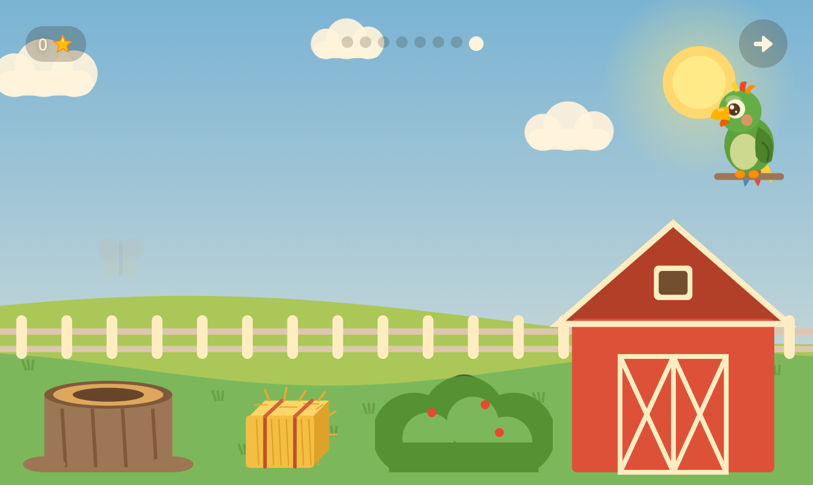

# Puki 🦜 · פוקי

A Hebrew/English Android game for toddlers (ages 2–4), with **פוקי**, a talking parrot
whose brain runs on your own PC. No cloud, no ads, no tracking, and nothing ever leaves
your home.


## What's inside

**The game:** an island world with toddler-sized games, each in its own illustrated scene
(a farm, a garden, a playground under a rainbow, a theater stage, a cozy house):

- **Animal Garden:** feed each animal the right food. The animal munches and does a happy hop.
- **Colors, Shapes, Counting, Letters:** pop the right balloon, drag chunky shapes into place,
  count flowers into a garden bed, find the letter block, all with spoken Hebrew prompts.
  Nothing stands in rows: balloons float high and low, shapes lie around the target, and
  every round is arranged a little differently.
- **Music:** a drum, a xylophone, a tambourine and maracas on a stage, each with its own sound
  (the xylophone walks up and down a scale), then repeat a little tune.
- **My Day:** a cutaway house with a scene for each routine: soap the muddy spots off a child
  in the bath, set the plate, cup, fork and spoon on a table, dress the child from an open
  wardrobe, put the toys away around a room, brush teeth, and bedtime.
- **Drawing** on paper taped to an easel, with big paint pots, and Puki looking at the picture.
  A **sticker album** fills up as stars are earned.
- **Peekaboo barn:** an animal hides on the farm (in the barn, behind the bush or the haystack,
  in a tree stump) and its sound gives it away. Tapping the right spot brings it out; any other
  spot sends out a butterfly and the animal peeks and calls again.
- **Echo Puki:** the child says anything and Puki says it back in a silly parrot voice (her own
  recording, played higher and faster). No PC needed, and nothing is kept.
- **Say it with Puki:** a picture appears, Puki says the word, and the child says it back.
  With the PC listening, the word itself moves the game on: after another word Puki says
  "listen well" and the word again, after a near miss "almost", up to three tries, and Puki
  always closes by saying the word the right way. With the PC off, any try counts.

Toddler-first design: no reading needed, big tap targets, no failure states (wrong answers
get a gentle shake and "let's try again"), and every line spoken in a warm voice. When the
parent's time limit is up there's no countdown: evening falls over the game, Puki yawns and
waves goodbye, and the music fades. Everything
answers a touch: pieces squish when pressed, bob while they wait, and burst into stars when
they're right. Hebrew
instructions follow the child's gender (תלחצי / תלחץ), set in parent settings. All voice lines
are generated offline with [BlueTTS](https://github.com/maxmelichov/BlueTTS).

**פוקי, the companion (optional).** A parrot sits in the corner of the games. When it
can reach a PC at home running the [brain server](brain/README.md):

- it comments on what the child just did, written live by a local **Gemma 4 E4B** and spoken
  by BlueTTS (about a second per reply);
- holding the parrot lets the child talk to it, and a Hebrew-tuned **Whisper** from
  [ivrit.ai](https://huggingface.co/ivrit-ai) transcribes the recording on the PC;
- it **looks at the child's drawings** and reacts to them, using Gemma's vision;
- at the end of the bedtime routine it tells a short, calm **bedtime story** about the
  child's day, one sentence at a time, each with a matching picture;
- in Animal Garden it asks "**מה החתול אומר?**" and listens hands-free; any answer makes the
  animal reply with its sound;
- if the PC is off or out of reach, the parrot just doesn't show up and the game uses its
  recorded voices.

On the PC, a small **dashboard** (http://127.0.0.1:8793, visible on that PC only) shows
whether the brain is awake, the pairing code, and a live log of what the child said and
what Puki answered.

| | |
|---|---|
|  |  |
|  |  |
|  |  |
|  | |

## Why the brain is on a PC

Toddler tablets tend to be cheap and weak (this was built for a Galaxy Tab A7 Lite with 3 GB
of RAM). A language model, Hebrew speech recognition and Hebrew TTS together need far more,
so the tablet stays the screen and a PC on the home network does the thinking.

**Or on a high-end phone.** On a phone with about 12 GB of memory (tested on a Galaxy S25), Puki
can think, talk and listen on the device itself, away from home too. In parent settings,
"Puki on this phone" downloads the models once (about 5.9 GB: Gemma 4 E4B for LiteRT-LM, the
BlueTTS voice and the Hebrew Whisper) and switches over. On the phone Gemma runs on the GPU
(the first word in under a second), the voice takes about 0.6 s for a line, and Whisper about
2 s for a word. For now it speaks Hebrew only there; English falls back to the recorded lines
(the plan is Android's own offline voices, see the [roadmap](ROADMAP.md)).

## Privacy and security

- **Nothing leaves your home.** The models run on your PC, and the tablet talks only to that
  PC over your Wi-Fi. No accounts, ads, analytics or cloud calls. The one exception: about
  once a day the app asks GitHub whether there's a newer version (a plain list request,
  with nothing about the child in it).
- **A pairing code** keeps other devices on the network out. The PC makes the code on first
  start, and the app gets it by scanning the QR code on the PC's dashboard (or you type it
  once). Requests without it are refused, and a device that keeps guessing is locked out.
- **The child's name** lives only on the tablet and your PC, and the files that hold it are
  git-ignored.
- **The live log** of what the child said is kept in the PC's memory only, and is gone when
  the server stops. The dashboard is never served to the network.
- **Firewall:** the setup opens one port (8790) for home networks only. Keep your home Wi-Fi
  set to *Private* in Windows, and don't give Python itself a firewall exception.
- **Signed releases:** every APK on the releases page (from 0.4.1) is signed with Puki's release
  key, certificate SHA-256
  `a799cab5bcf83c20c754490f8d0eb271cf844e2b7e69518760789f2a96eb3c3d`. Android only installs an
  update signed with the same key as the installed app, so a changed Puki can't come in as an
  update. To check a download: `apksigner verify --print-certs Puki-<version>.apk`.
- **Pinned downloads:** the PC installer downloads only files listed in `brain/pins.json`
  (Hugging Face files at a fixed commit, and every file's SHA-256), and refuses anything that
  doesn't match, so a file changed upstream never reaches your PC.
- **Echo Puki's recordings** go straight to the speaker a moment later and are never stored or
  sent anywhere.
- **Encrypted:** the tablet and PC talk over HTTPS. The PC makes its own certificate on first
  start, and the pairing QR code carries its fingerprint, so the app talks only to that PC:
  another machine on the network can neither read the child's voice and name nor pose as the
  PC. (Typed in by hand instead of scanned, the app trusts the PC it first reaches with the
  right code, then holds it to that certificate.)

## Getting started

**The app** (Android Studio, or the command line):

```
./gradlew installDebug
```

- Minimum Android 8 (API 26). Built for tablets in landscape.
- On first launch, a short welcome screen asks for the language, the child's name, girl/boy,
  and (optionally) the companion: scan the QR code on the PC's dashboard, or type its address
  and pairing code.
- Parent settings: long-press the gear on the hub. There you can change all of the above,
  plus separate volumes for music, voices (and Puki) and sound effects, and a time limit.
- Music: "Puki main theme" plays in the hub and games, and "Puki nights" plays during the
  bedtime routine, dipping under the bedtime story. To use your own, replace
  `app/src/main/res/raw/music_hub.mp3` and `music_night.mp3`.

**Updates:** the app updates itself from this repo's
[releases](https://github.com/TomSadeh/puki/releases). When there's a newer version, a red dot
shows on the gear; in the parent settings, tap **Update**. The first time, Android asks you to
let Puki install apps (a switch on the next screen); after that, each update just asks you to
confirm. Progress, stars and settings are kept. You can also install the APK from the releases
page by hand.

**The companion:** on Windows, run **Puki.exe** from the
[releases](https://github.com/TomSadeh/puki/releases) (or `python brain\install.py` from this
repo); on Linux, `python3 brain/install.py`. It downloads
everything (about 9 GB), sets up the firewall and autostart, and shows the pairing code; see
[brain/README.md](brain/README.md). Ideally the PC has an NVIDIA GPU with about 6 GB of free
VRAM (it falls back to the CPU otherwise).
Pair the app by scanning the QR code on the PC's dashboard (http://127.0.0.1:8793). The code
is also in `brain/pairing_code.txt`, to type in with the PC's address instead.

**Personal voice lines:** the game can say the child's name ("כל הכבוד, ___!"). The first time
the companion is reachable, Puki records these lines onto the tablet, so they also play when
the PC is off. The name only ever lives on the tablet and your PC. To bake them into the app
instead (they're git-ignored, so the name never ends up in a repo):

```
python scripts/generate_voices.py --bluetts-dir ~/puki-brain/BlueTTS --child-name "<name>" --child-gender girl
```

## Project layout

```
app/                       Android app (Kotlin, Jetpack Compose)
brain/                     companion server for the PC: doorbell.py (HTTPS front door),
                           brain.py + persona.py (Gemma, the voice, Whisper), tls.py
                           (its certificate), dashboard, install.py, pins.json (pinned
                           downloads; make_pins.py), tray.py / build_exe.py (Puki.exe)
native/whisper/            builds whisper.cpp for the phone (prebuilt in app/src/main/jniLibs)
scripts/generate_voices.py all voice lines, generated with BlueTTS
scripts/check_voices.py    checks every voice line the app plays has audio
scripts/generate_instruments.py  the music game's instrument sounds
scripts/release.py         builds the APK and publishes it as a GitHub release
scripts/draw_companion.py  draws the parrot
CLAUDE.md                  conventions for working on the code (also read by Claude Code)
```

## Notes for developers

- **BlueTTS and nikud:** BlueTTS's Hebrew pronunciation model garbles text that already has
  nikud, so all text is fed to it plain. Words plain spelling can't disambiguate (letter
  names, animal sounds) are given as phonemes in `generate_voices.py`.
- **The brain on the phone** (`app/src/main/java/io/github/tomsadeh/puki/brain/`): `LocalBrain` answers the
  same requests as the PC brain, with `Persona` (a port of brain.py's prompts and line filter),
  `voice/` (a Kotlin port of BlueTTS's pipeline, checked to match Python sample for sample),
  `Mind` (Gemma through LiteRT-LM) and `Ears` (whisper.cpp). The whisper.cpp library is prebuilt
  in `app/src/main/jniLibs`; rebuild it with `python native/whisper/build.py` (needs the NDK).
- **Releasing:** bump `pukiVersion` in `app/build.gradle.kts`, commit, then run
  `python scripts/release.py --publish` from this checkout. It refuses if personal voice lines
  (`voice_*_name*`) are in `res/raw`, so a release never carries a child's name, and if the APK
  is signed with the debug key (releases use the key in `~/keys`, see `app/build.gradle.kts`).
  When the PC side changed, also build Puki.exe (`python brain/build_exe.py`) and attach it:
  it carries its own copy of the brain's code.
- **Tests:** `./gradlew testDebugUnitTest`, `python -m pytest brain/tests` and
  `python scripts/check_voices.py` (CI runs all three). On a device, the debug build's
  self-test: `adb shell am broadcast -n io.github.tomsadeh.puki/.SelfTestReceiver`
  (`adb logcat -s PukiSelfTest`), with `-e host <ip:port> -e code <CODE> -e pin <fingerprint>`
  to check the HTTPS connection to a PC, `-e timelimit 1` to see the goodbye after a minute
  (`0` turns it off again), or `-e echotest 1` for the parrot voice.
- **Changing an installer download:** after a version or model change in `brain/install.py`, run
  `python brain/make_pins.py` and commit the new `pins.json`.
- **Adding a voice line:** add it to `voice_lines` in `scripts/generate_voices.py`, generate it,
  then run `scripts/check_voices.py`.

## Credits

- Music ("Puki main theme", "Puki nights") by the project's author: piano, produced with Suno
- [BlueTTS](https://github.com/maxmelichov/BlueTTS) by Max Melichov: Hebrew/English text-to-speech
- [ivrit.ai](https://huggingface.co/ivrit-ai): Hebrew fine-tuned Whisper
- [Parakeet TDT 0.6B v2](https://huggingface.co/nvidia/parakeet-tdt-0.6b-v2) by NVIDIA (CC-BY-4.0), hears English;
  ONNX export by [istupakov](https://huggingface.co/istupakov/parakeet-tdt-0.6b-v2-onnx)
- [Gemma](https://ai.google.dev/gemma) by Google, subject to the
  [Gemma terms of use](https://ai.google.dev/gemma/terms); GGUF builds by [Unsloth](https://huggingface.co/unsloth)
- [llama.cpp](https://github.com/ggml-org/llama.cpp) and
  [faster-whisper](https://github.com/SYSTRAN/faster-whisper)
- On the phone: [LiteRT-LM](https://github.com/google-ai-edge/LiteRT-LM) (Apache-2.0) runs Gemma,
  [ONNX Runtime](https://onnxruntime.ai) (MIT) runs BlueTTS and
  [RenikudPlus](https://huggingface.co/notmax123/RenikudPlus) (Hebrew pronunciation), and
  [whisper.cpp](https://github.com/ggml-org/whisper.cpp) (MIT) runs ivrit.ai's Whisper

Models are downloaded separately and are not part of this repository.

## What's next

A sticker moment and a progress page for the parent; English and a faster start for the
phone brain; games that feel better; a few more small toys. Later, a memory that stays in your
home, so Puki remembers yesterday. See [ROADMAP.md](ROADMAP.md).

## Contributing

Pull requests are welcome. The rules come from the audience: no failure states, nothing the
child has to read, big targets, both languages, and nothing that leaves the home. See
[CONTRIBUTING.md](CONTRIBUTING.md) for what gets accepted and what a PR needs to show.

## License

[MIT](LICENSE). Built with lots of help from [Claude Code](https://claude.com/claude-code).
