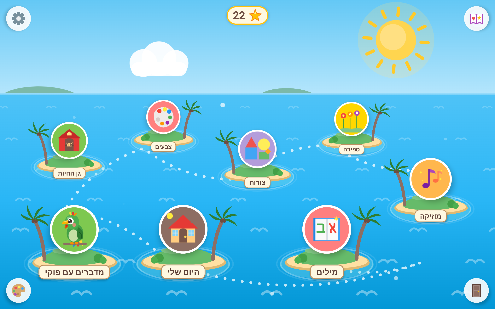
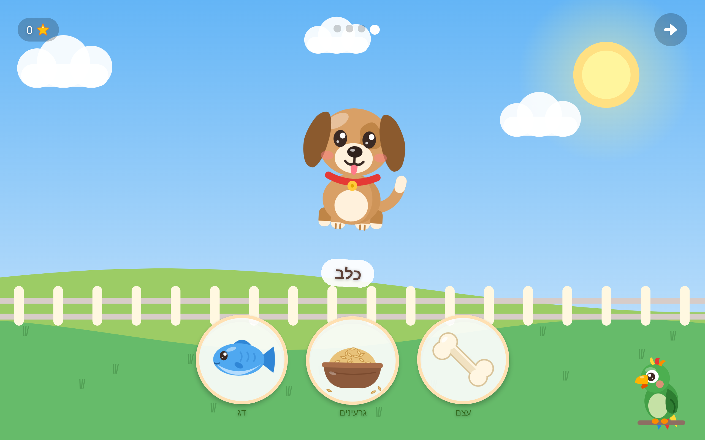
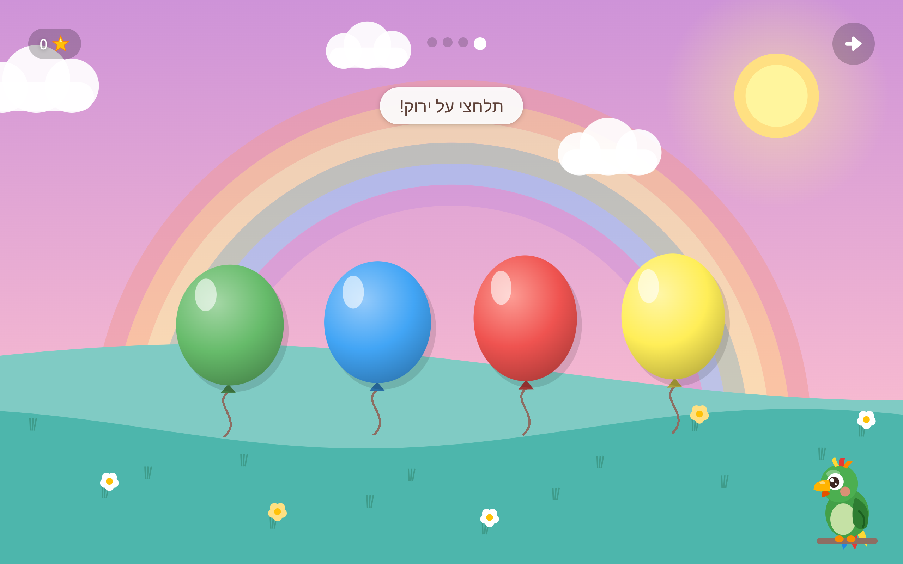
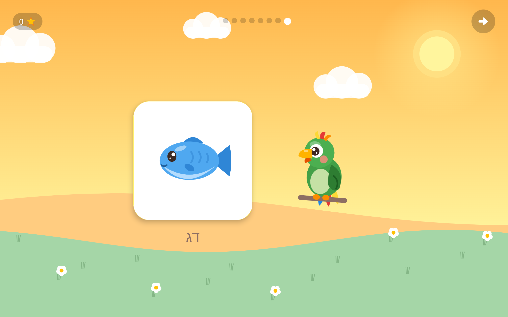
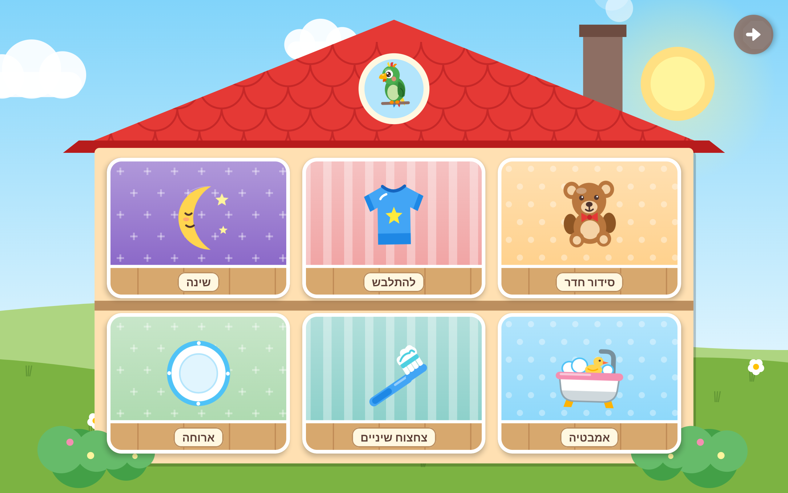
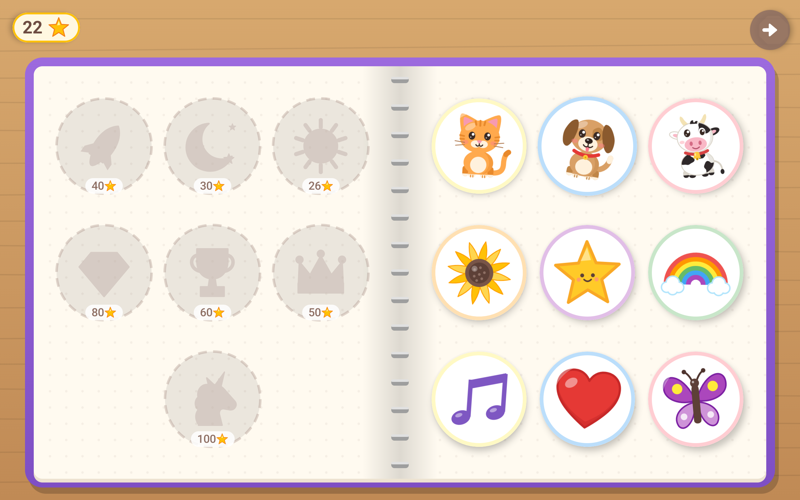

# Puki 🦜 · עולם קטן

A Hebrew/English Android game for toddlers (ages 2–4), with **פוקי**, a talking parrot
whose brain runs on your own PC. No cloud, no ads, no tracking, and nothing ever leaves
your home.



## What's inside

**The game (Olam Katan, "a small world")**, an island world with toddler-sized games, each in
its own illustrated scene (a farm, a garden, a playground under a rainbow, a theater stage, a
cozy house):

- **Animal Garden:** feed each animal the right food. The animal munches and does a happy hop.
- **Colors, Shapes, Counting, Letters:** pop the right balloon, drag chunky shapes into place,
  count flowers into a garden bed, find the letter block, all with spoken Hebrew prompts.
- **Music:** play instruments, then repeat a little melody.
- **My Day:** a cutaway house with bath time, brushing teeth, getting dressed, setting the
  table, tidying up and bedtime.
- **Drawing** on paper taped to an easel, with big paint pots, and Puki looking at the picture.
  A **sticker album** fills up as stars are earned.
- **Say it with Puki:** a picture appears, Puki says the word, and the child says it back.
  With the PC listening, the word itself moves the game on: after another word Puki says
  "listen well" and the word again, after a near miss "almost", up to three tries, and Puki
  always closes by saying the word the right way. With the PC off, any try counts.

Toddler-first design: no reading needed, big tap targets, no failure states (wrong answers
get a gentle shake and "let's try again"), and every line spoken in a warm voice. Everything
answers a touch: pieces squish when pressed, bob while they wait, and burst into stars when
they're right. Hebrew
instructions follow the child's gender (תלחצי / תלחץ), set in parent settings. All voice lines
are generated offline with [BlueTTS](https://github.com/maxmelichov/BlueTTS).

**פוקי, the companion (optional).** A parrot sits in the corner of the games. When it
can reach a PC at home running the [brain server](brain/README.md):

- it comments on what the child just did, written live by a local **Gemma 4 E4B** and spoken
  by BlueTTS (about a second per reply);
- holding the parrot lets the child talk to it, and a Hebrew-tuned **Whisper** from
  [ivrit.ai](https://huggingface.co/ivrit-ai) transcribes the recording on the PC;
- it **looks at the child's drawings** and reacts to them, using Gemma's vision;
- at the end of the bedtime routine it tells a short, calm **bedtime story** about the
  child's day, one sentence at a time, each with a matching picture;
- in Animal Garden it asks "**מה החתול אומר?**" and listens hands-free; any answer makes the
  animal reply with its sound;
- if the PC is off or out of reach, the parrot just doesn't show up and the game uses its
  recorded voices.

On the PC, a small **dashboard** (http://127.0.0.1:8793, visible on that PC only) shows
whether the brain is awake, the pairing code, and a live log of what the child said and
what Puki answered.

| | |
|---|---|
|  |  |
|  |  |
|  | |

## Why the brain is on a PC

Toddler tablets tend to be cheap and weak (this was built for a Galaxy Tab A7 Lite with 3 GB
of RAM). A language model, Hebrew speech recognition and Hebrew TTS together need far more,
so the tablet stays the screen and a PC on the home network does the thinking. On a high-end
tablet the whole stack could run on the device; contributions welcome.

## Privacy and security

- **Nothing leaves your home.** The models run on your PC, and the tablet talks only to that
  PC over your Wi-Fi. No accounts, ads, analytics or cloud calls.
- **A pairing code** keeps other devices on the network out. The PC makes the code on first
  start, and you type it once in the app. Requests without it are refused, and a device that
  keeps guessing is locked out.
- **The child's name** lives only on the tablet and your PC, and the files that hold it are
  git-ignored.
- **The live log** of what the child said is kept in the PC's memory only, and is gone when
  the server stops. The dashboard is never served to the network.
- **Firewall:** the setup opens one port (8790) for home networks only. Keep your home Wi-Fi
  set to *Private* in Windows, and don't give Python itself a firewall exception.
- The tablet and PC talk over plain HTTP inside your network. The pairing code keeps out
  guests' devices; it isn't meant to stop someone who already controls your network.

## Getting started

**The app** (Android Studio, or the command line):

```
./gradlew installDebug
```

- Minimum Android 8 (API 26). Built for tablets in landscape.
- On first launch, a short welcome screen asks for the language, the child's name, girl/boy,
  and the companion's PC address and pairing code (optional).
- Parent settings: long-press the gear on the hub. There you can change all of the above,
  plus sounds, music and a time limit.
- Music: "Puki main theme" plays in the hub and games, and "Puki nights" plays during the
  bedtime routine, dipping under the bedtime story. To use your own, replace
  `app/src/main/res/raw/music_hub.mp3` and `music_night.mp3`.

**The companion:** on a Windows PC with Python, run `python brain\install.py`. It downloads
everything (about 9 GB), sets up the firewall and autostart, and shows the pairing code; see
[brain/README.md](brain/README.md). Ideally the PC has an NVIDIA GPU with about 6 GB of free
VRAM (it falls back to the CPU otherwise).
When it starts, it prints a pairing code (also on the dashboard and in
`brain/pairing_code.txt`). Enter it in the app with the PC's address.

**Personal voice lines:** the game can say the child's name ("כל הכבוד, ___!"). The first time
the companion is reachable, Puki records these lines onto the tablet, so they also play when
the PC is off. The name only ever lives on the tablet and your PC. To bake them into the app
instead (they're git-ignored, so the name never ends up in a repo):

```
python scripts/generate_voices.py --bluetts-dir ~/puki-brain/BlueTTS --child-name "<name>" --child-gender girl
```

## Project layout

```
app/                       Android app (Kotlin, Jetpack Compose)
brain/                     companion server for the PC (doorbell.py, brain.py, dashboard)
scripts/generate_voices.py all voice lines, generated with BlueTTS
scripts/check_voices.py    checks every voice line the app plays has audio
scripts/draw_companion.py  draws the parrot
CLAUDE.md                  conventions for working on the code (also read by Claude Code)
```

## Notes for developers

- **BlueTTS and nikud:** BlueTTS's Hebrew pronunciation model garbles text that already has
  nikud, so all text is fed to it plain. Words plain spelling can't disambiguate (letter
  names, animal sounds) are given as phonemes in `generate_voices.py`.
- **Adding a voice line:** add it to `voice_lines` in `scripts/generate_voices.py`, generate it,
  then run `scripts/check_voices.py`.

## Credits

- Music ("Puki main theme", "Puki nights") by the project's author: piano, produced with Suno
- [BlueTTS](https://github.com/maxmelichov/BlueTTS) by Max Melichov: Hebrew/English text-to-speech
- [ivrit.ai](https://huggingface.co/ivrit-ai): Hebrew fine-tuned Whisper
- [Parakeet TDT 0.6B v2](https://huggingface.co/nvidia/parakeet-tdt-0.6b-v2) by NVIDIA (CC-BY-4.0), hears English;
  ONNX export by [istupakov](https://huggingface.co/istupakov/parakeet-tdt-0.6b-v2-onnx)
- [Gemma](https://ai.google.dev/gemma) by Google, subject to the
  [Gemma terms of use](https://ai.google.dev/gemma/terms); GGUF builds by [Unsloth](https://huggingface.co/unsloth)
- [llama.cpp](https://github.com/ggml-org/llama.cpp) and
  [faster-whisper](https://github.com/SYSTRAN/faster-whisper)

Models are downloaded separately and are not part of this repository.

## What's next

A memory that stays in your home (so Puki remembers yesterday), more talking games,
English on par with Hebrew, pairing by scanning the dashboard's QR code, and a one-click
installer for the PC brain. See [ROADMAP.md](ROADMAP.md).

## License

[MIT](LICENSE). Built with lots of help from [Claude Code](https://claude.com/claude-code).
