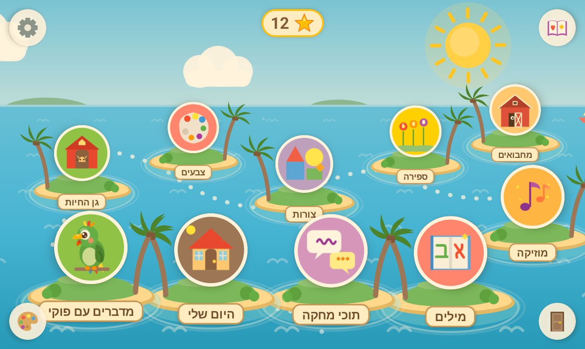
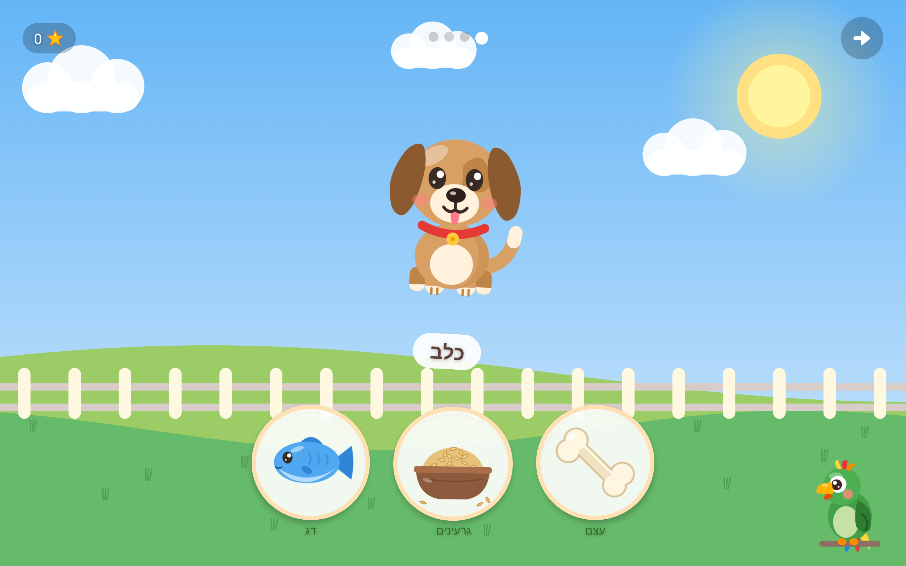
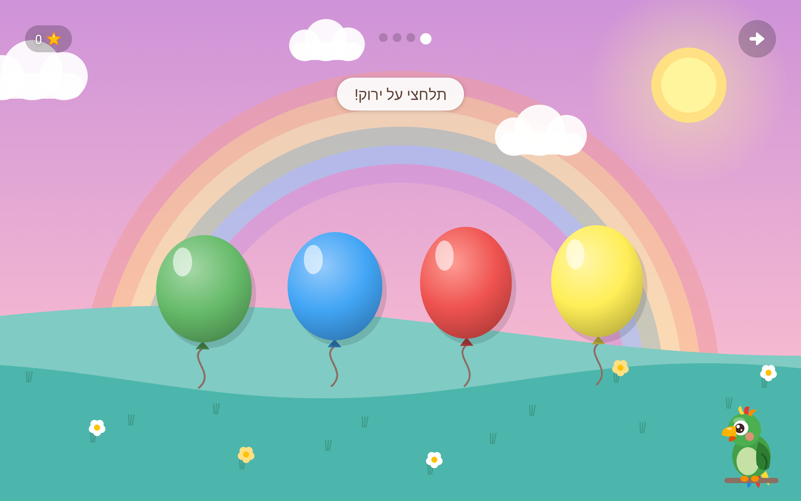
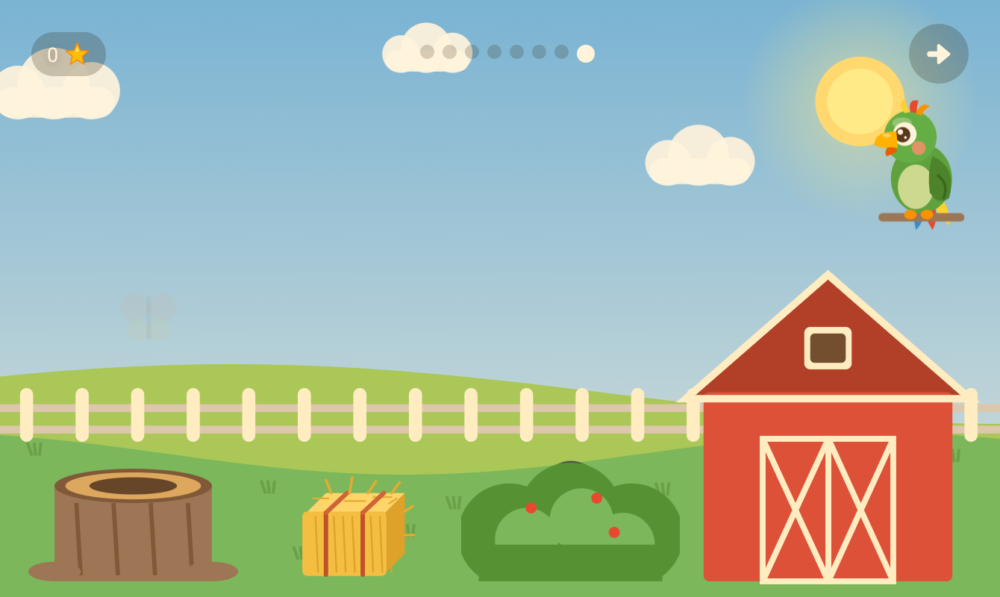
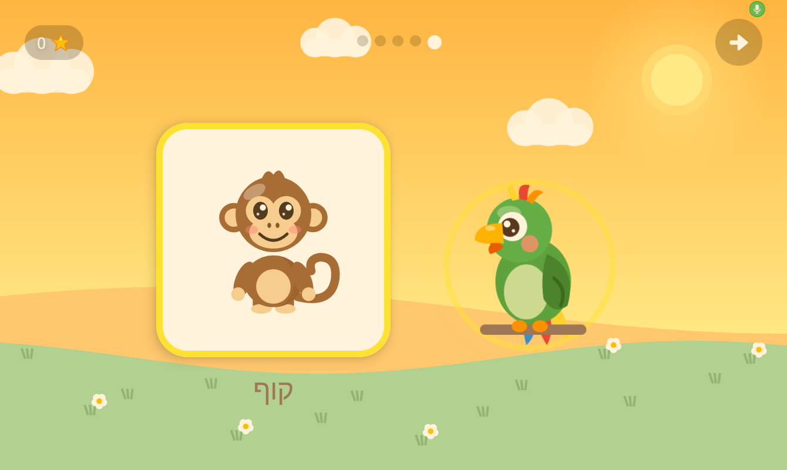
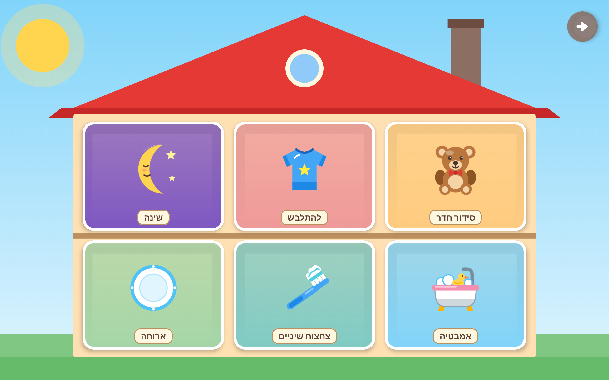
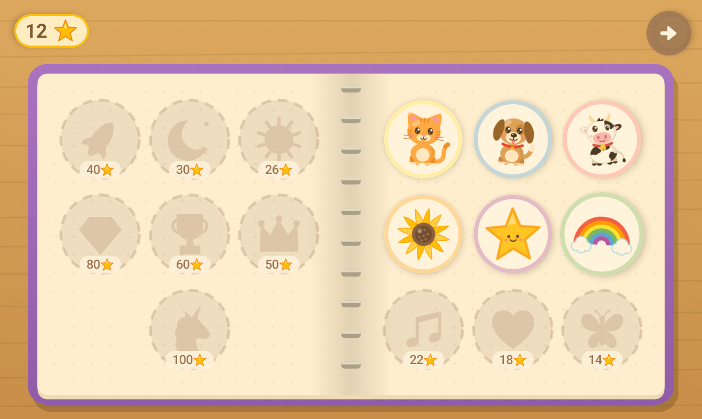

# Puki 🦜 · פוקי

A free Hebrew/English Android game for toddlers (ages 2–4), with **פוקי**, a talking parrot.
No cloud, no ads, no tracking, and nothing about your child ever leaves the device. Open
source, under the MIT license.

**Website:** [pukiparrot.com](https://pukiparrot.com/) (Hebrew and English, with the latest download)



## Why Puki exists

I made Puki because I got tired of toddler games that stop in the middle to ask for money. My
daughter would get into a game, love it, and then a screen would pop up: pay, watch an ad,
unlock the next level. A two-year-old can't understand any of that. All she learns is that the
fun suddenly ends.

So Puki is **free, forever**: no price, no in-app purchases, no subscriptions, no "full
version", no ads. It will never ask for money, and there's no payment code in it at all. The
only thing that ends the fun is the time limit the parents set, and even that ends with a calm
goodbye. It's open source (MIT), so nobody can ever lock it behind a payment.

## What's inside

**The game:** an island world with toddler-sized games, each in its own illustrated scene
(a farm, a garden, a playground under a rainbow, a theater stage, a cozy house):

- **Animal Garden:** feed each animal the right food. The animal munches and does a happy hop.
- **Colors, Shapes, Counting, Letters:** pop the right balloon, drag chunky shapes into place,
  count flowers into a garden bed, find the letter block, all with spoken Hebrew prompts.
  Nothing stands in rows: balloons float high and low, shapes lie around the target, and
  every round is arranged a little differently.
- **Music:** a drum, a xylophone, a tambourine and maracas on a stage, each with its own sound
  (the xylophone walks up and down a scale), then repeat a little tune.
- **My Day:** a cutaway house with a scene for each routine: soap the muddy spots off a child
  in the bath, set the plate, cup, fork and spoon on a table, dress the child from an open
  wardrobe, put the toys away around a room, brush Teddy's teeth (toothpaste, scrub, swish),
  bake a cake in the kitchen, wash a muddy car in the garage, and bedtime.
- **Drawing** on paper taped to an easel, with big paint pots, an eraser, stamps, color-in
  pages and tracing, and a camera that saves the picture.
  A **sticker album** fills up as stars are earned.
- **Peekaboo barn:** an animal hides on the farm (in the barn, behind the bush or the haystack,
  in a tree stump) and its sound gives it away. Tapping the right spot brings it out; any other
  spot sends out a butterfly and the animal peeks and calls again.
- **Echo Puki:** the child says anything and Puki says it back in a silly parrot voice (her own
  recording, played higher and faster). No brain needed, and nothing is kept.
- **Say it with Puki:** a picture appears, Puki says the word, and the child says it back.
  With the device brain on, the word itself moves the game on: after another word Puki says
  "listen well" and the word again, after a near miss "almost", up to three tries, and Puki
  always closes by saying the word the right way. Without it, any try counts.

Toddler-first design: no reading needed, big tap targets, no failure states (wrong answers
get a gentle shake and "let's try again"), and every line spoken in a warm voice. When the
parent's time limit is up there's no countdown: evening falls over the game, Puki yawns and
waves goodbye, and the music fades. Everything answers a touch: pieces squish when pressed,
bob while they wait, and burst into stars when they're right. Hebrew instructions follow the
child's gender (תלחצי / תלחץ), set in parent settings. All voice lines are generated offline
with [BlueTTS](https://github.com/maxmelichov/BlueTTS).

| | |
|---|---|
|  |  |
|  |  |
|  |  |
|  | |

## Puki's brain, on the device (optional)

Puki works in one of two ways:

- **Recorded lines (the default).** Everything in the game is spoken from recorded lines, and
  the parrot answers taps with recorded giggles and squawks. Nothing to download.
- **The device brain.** Puki writes his own lines about what the child just did, speaks them,
  and listens when she talks to him. Holding the parrot lets her talk to it; after a question
  ("which color?", "how many?", "who's hiding?") he listens for a few seconds, so she can **say
  the answer instead of tapping** it. It speaks Hebrew only for now; in English the game uses
  its recorded lines. Drawings and bedtime stories use recorded lines for now too.

The device brain is a one-time download of about 0.5 GB (538 MB) from Hugging Face. A parent
starts it from the **Puki on this device** card in parent settings. After that it works
offline. On a Galaxy Tab A7 Lite a reply takes about 1.5 s, from what happened to Puki
speaking.

It's four small models, all ONNX int8:

| Model | What it does | Where it comes from |
|---|---|---|
| [**Brains**](https://huggingface.co/dtsj89/puki-brains) | Writes Puki's lines, and rates what the child said (the safety gate) | A 46M-parameter model trained from scratch for Puki: pretrained on 1.6B tokens (about 74% Hebrew), then fine-tuned on 46k of Puki's lines. See [train/](train/README.md). |
| [**Beak**](https://huggingface.co/dtsj89/puki-beak) | Reads plain Hebrew into phonemes, so the voice says it right | 2.3M parameters, trained by us: pretrained on 600k sentences labelled by RenikudPlus, fine-tuned on reviewed lines |
| [**Syrinx**](https://huggingface.co/dtsj89/puki-syrinx) | Puki's voice | BlueTTS with the Noa voice, its vector estimator and vocoder rewritten and quantized to int8 for weak tablets. Not trained by us. |
| [**Ears**](https://huggingface.co/dtsj89/puki-ears) | Hears the child, in Hebrew and English | kol-stream by MaorB, exported for phones. Not trained by us. |

Every file is pinned by size and SHA-256 in the app (`DeviceModels.kt`), so a changed file is
refused. A parent can delete the models again from the same card.

### What Puki may say

- **What the child says is checked first.** Word lists catch hurt, danger, wanting a parent,
  big questions and secrets, and then Brains' own gate rates what she said. Either one gives a
  fixed, gentle reply that points to mommy or daddy; the model never writes those. If the gate
  isn't sure, Puki answers with a neutral line.
- **Every line Puki writes is checked after.** A filter lets through only short, clean lines,
  with no promises ("mommy is on her way") and no bonding ("best friend", "I love you"). A line
  that fails is dropped, and the game plays a recorded line instead.
- **Parents see what Puki said.** In parent settings, "What Puki said" lists his recent lines.
  A parent can flag one that wasn't right; the report goes by the parent's own email.

## Requirements

- Android 8 (API 26) or newer. Built for tablets in landscape; phones work too.
- **For the device brain:** a 64-bit ARM device with about 3 GB of memory, and about 0.5 GB of
  free space. The card only appears on devices that can run it.

## Privacy and security

- **Nothing about the child leaves the device.** No accounts, ads, analytics or cloud calls.
- **The voice is understood on the device,** and no recording is kept. Echo Puki's recordings
  go straight to the speaker a moment later and are never stored or sent.
- **The child's words** are held in memory only for the parent's "What Puki said" list, and
  are forgotten when the game closes.
- **The brain keeps no memory** beyond its last few lines.
- **The child's name** lives only on the device. The files that would hold it in this repo are
  git-ignored.
- **The network** is used for two things only: the model download a parent asks for, and,
  in the GitHub build, about once a day a check whether there's a newer version (a plain list
  request, with nothing about the child in it).
- **Signed releases:** every APK on the releases page (from 0.4.1) is signed with Puki's release
  key, certificate SHA-256
  `a799cab5bcf83c20c754490f8d0eb271cf844e2b7e69518760789f2a96eb3c3d`. Android only installs an
  update signed with the same key as the installed app, so a changed Puki can't come in as an
  update. To check a download: `apksigner verify --print-certs Puki-<version>.apk`.

## Installing

- **APK:** download the latest `Puki-<version>.apk` from the
  [releases](https://github.com/TomSadeh/puki/releases) (or the [website](https://pukiparrot.com/))
  and open it on the tablet.
- **Obtainium:** add `https://github.com/TomSadeh/puki` in
  [Obtainium](https://github.com/ImranR98/Obtainium) to get each new release.
- **Google Play:** coming soon.

**First launch:** a short welcome screen asks for the language, the child's name, and girl/boy.

**Parent settings:** long-press the gear on the hub, then tap the number written out in words
(a toddler can hold a button, but can't read "seventeen"). There you can change all of the
above, turn on the device brain, see what Puki said, and set separate volumes for music, voices
(and Puki) and sound effects, which games show on the map, and a time limit. The limit holds
even if the app is closed; a new allowance starts after an hour away, or when you end the
goodbye.

**Updates:** the GitHub build updates itself from this repo's releases. When there's a newer
version, a red dot shows on the gear; in the parent settings, tap **Update**. The first time,
Android asks you to let Puki install apps (a switch on the next screen); after that, each
update just asks you to confirm. Progress, stars and settings are kept.

**Personal voice lines:** the game can say the child's name ("כל הכבוד, ___!"). When the device
brain is on, Puki records these lines onto the device (in Hebrew, for now), so they play at
once, even with the brain off later. The name never leaves the device.

## Moving from the PC brain

Until 0.8, Puki's brain could run on a PC at home. In 0.9.0 the PC brain is **retired**: the
app no longer talks to a PC, and the device brain does its job. If your family used it:

1. **Update the app** to 0.9.0 or newer.
2. **Turn on the device brain:** parent settings, **Puki on this device**, then download.
3. **Remove the PC program.** It installed a login shortcut, a firewall rule, and about 10 GB
   of models. To remove all of it:
   - **Puki.exe (Windows):** right-click Puki's tray icon (behind the **^** arrow if you don't
     see it), choose **Uninstall Puki...**, and answer yes to each part. Then delete Puki.exe.
   - **Installed from this repo:** run `python brain\install.py --uninstall` on Windows, or
     `python3 brain/install.py --uninstall` on Linux (add `--dir <folder>` if you installed it
     somewhere other than `~/puki-brain`). It stops Puki and asks before removing each part:
     the login shortcut (or the `puki` systemd user service on Linux), the firewall rule, the
     models, and your settings and pairing code.
   - **By hand:** quit Puki; delete the "Puki brain" shortcut from `shell:startup`; in an
     administrator PowerShell, run `Remove-NetFirewallRule -DisplayName "Puki companion"`;
     then delete the folder it ran from (`~/puki-brain`, or `%LOCALAPPDATA%\Puki` for Puki.exe).

The details are at the top of [brain/README.md](brain/README.md).

## Project layout

```
app/                       Android app (Kotlin, Jetpack Compose)
app/.../puki/brain/        the device brain: LocalBrain (routes), Brains, Bpe, Persona, Safety,
                           KolEars, SpokenAnswer, DeviceModels (pinned downloads), voice/ (Beak,
                           BlueVoice)
train/                     how Puki's models are made (see train/README.md)
brain/                     the retired PC brain (Python); safety.py, persona.py and
                           pronunciation.tsv are still the source for the app and train/
scripts/generate_voices.py all voice lines, generated with BlueTTS
scripts/check_voices.py    checks every voice line the app plays has audio
scripts/sync_safety_kt.py  copies safety.py's word lists into Safety.kt (--check compares)
scripts/safety_eval.py     the safety stress test
scripts/generate_instruments.py  the music game's instrument sounds
scripts/release.py         builds the APK and publishes it as a GitHub release
scripts/draw_companion.py  draws the parrot
CLAUDE.md                  conventions for working on the code (also read by Claude Code)
```

## Building and testing

```
./gradlew installGithubDebug
```

- **BlueTTS and nikud:** BlueTTS's Hebrew pronunciation model garbles text that already has
  nikud, so all text is fed to it plain. Words plain spelling can't disambiguate (letter
  names, animal sounds) are given as phonemes in `generate_voices.py`. On the device, Beak
  reads plain Hebrew into phonemes.
- **The device brain** (`app/src/main/java/io/github/tomsadeh/puki/brain/`): `LocalBrain`
  answers the game's requests (`Brain.kt` is the interface) with `Brains` (Puki's lines and the
  gate, tokenized by `Bpe`), `Persona` and `Safety` (the filter and nets, ported from
  `brain/persona.py` and `brain/safety.py`), `voice/` (`Beak` reads, `BlueVoice` speaks: a
  Kotlin port of BlueTTS's pipeline) and `KolEars` (kol-stream through ONNX Runtime). The
  benches in `androidTest` time each model on a device:
  `gradlew connectedGithubDebugAndroidTest -Ppuki.bench` installs them as a separate app.
- **Music:** "Puki main theme" plays in the hub and games, and "Puki nights" plays during the
  bedtime routine. Dance and Freeze plays `music_dance.mp3` when it's there (otherwise the main
  theme). To use your own, replace `app/src/main/res/raw/music_hub.mp3`, `music_night.mp3` and
  `music_dance.mp3`.
- **Personal voice lines in the build:** to bake the child's name lines into the app instead
  (they're git-ignored, so the name never ends up in a repo):
  `python scripts/generate_voices.py --bluetts-dir <BlueTTS folder> --child-name "<name>" --child-gender girl`
- **Releasing:** bump `pukiVersion` in `app/build.gradle.kts`, commit, then run
  `python scripts/release.py --publish` from this checkout. It refuses if personal voice lines
  (`voice_*_name*`) are in `res/raw`, so a release never carries a child's name, and if the APK
  is signed with the debug key (releases use the key in `~/keys`, see `app/build.gradle.kts`).
- **Tests:** `./gradlew testGithubDebugUnitTest`, `python -m pytest brain/tests`,
  `python scripts/sync_safety_kt.py --check` and `python scripts/check_voices.py` (CI runs
  them all). On a device, the debug build's self-test:
  `adb shell am broadcast -n io.github.tomsadeh.puki/.SelfTestReceiver`
  (`adb logcat -s PukiSelfTest`), with `-e timelimit 1` to see the goodbye after a minute
  (`0` turns it off again), or `-e echotest 1` for the parrot voice.
- **Changing a model:** put the new files' sizes and SHA-256 in `DeviceModels.kt`, update
  `train/pt_manifest.json` if the pretraining changed, and re-run the truth and safety checks
  (`train/sft_small.py`'s held-out scoring: the filter, the gate and the truth checks) before a
  release.
- **Adding a voice line:** add it to `voice_lines` in `scripts/generate_voices.py`, generate it,
  then run `scripts/check_voices.py`.

## Credits

- Music ("Puki main theme", "Puki nights" and the Dance and Freeze track) by the project's
  author, Tom Sadeh: piano, produced with Suno; [CC BY 4.0](LICENSE-music.md)
- [AndroidX and Jetpack Compose](https://developer.android.com/jetpack) by Google (Apache-2.0)
- [ONNX Runtime](https://onnxruntime.ai) by Microsoft (MIT) runs all four models
- [BlueTTS](https://github.com/maxmelichov/BlueTTS) by Max Melichov (MIT): Puki's voice, with
  the Noa voice, and the recorded lines
- [RenikudPlus](https://huggingface.co/notmax123/RenikudPlus) by Max Melichov, Yakov Kolani and
  Morris Alper (Apache-2.0): Beak learned to read Hebrew from it
- [espeak-ng](https://github.com/espeak-ng/espeak-ng) (GPL-3.0): English Beak learned to read from
  its pronunciations (only its output; espeak-ng itself isn't part of Puki)
- [kol-stream](https://huggingface.co/MaorB/embeddinggemma-2-asr-hebrew-english-streaming) by
  MaorB (Apache-2.0), on Google's EmbeddingGemma 2, trained with
  [ivrit.ai](https://huggingface.co/ivrit-ai)'s data (CC BY 4.0) and LibriSpeech: Puki's ears
- The Hebrew Brains' pretraining text: [FineWeb-2](https://huggingface.co/datasets/HuggingFaceFW/fineweb-2)
  (heb_Hebr) by Hugging Face (ODC-By, and the Common Crawl terms of use)
- The English Brains' pretraining text:
  - [FineWeb-Edu](https://huggingface.co/datasets/HuggingFaceFW/fineweb-edu) by Hugging Face
    (ODC-By, and the Common Crawl terms of use), which also gave English Beak its words
  - [Cosmopedia](https://huggingface.co/datasets/HuggingFaceTB/cosmopedia) by Hugging Face
    (Apache-2.0)
  - Project Gutenberg books and YouTube Commons videos from the
    [Common Pile](https://huggingface.co/common-pile) (public domain, and CC BY per video)
- Brains' fine-tuning lines were written by [DeepSeek](https://www.deepseek.com) models, then
  filtered by Puki's own checks; they're public as [dtsj89/puki-lines](https://huggingface.co/datasets/dtsj89/puki-lines)
  (CC BY 4.0)

The models are downloaded separately and are not part of this repository.

## What's next

Google Play, a few more pictures for Puki's games (a doll, a blanket, the sea), and whatever
families ask for. See [ROADMAP.md](ROADMAP.md).

## Contributing

Pull requests are welcome. The rules come from the audience: no failure states, nothing the
child has to read, big targets, both languages, and nothing about the child leaves the device.
See [CONTRIBUTING.md](CONTRIBUTING.md) for what gets accepted and what a PR needs to show. Porting the brain to another platform (iOS, say)? [PORTING.md](PORTING.md) describes the models
and how to check a port against the trainer's fixtures.
Questions, or something Puki said that wasn't right: [hello@pukiparrot.com](mailto:hello@pukiparrot.com).

## License

The code is [MIT](LICENSE). The music is [CC BY 4.0](LICENSE-music.md). Built with lots of help from [Claude Code](https://claude.com/claude-code).
